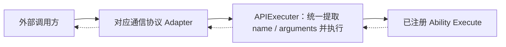
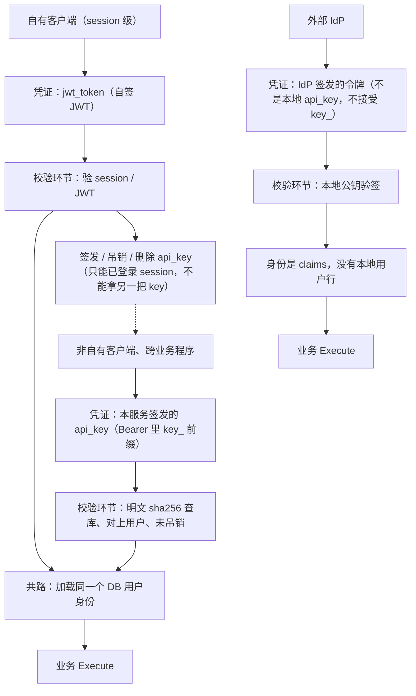

# project_template_go

Go 服务项目模版：统一 API 编排（JSON-RPC / MCP / WebSocket / gRPC 四协议同一调用链）+ Ability 装配 + MySQL/GORM + 开发测试台 + 文档生成，一条命令实例化为新项目。

## Quick Start

**已有 `go.mod`**（module path 自动读取，无需传参）：

```bash
cd my_project
wget -qO- https://raw.githubusercontent.com/0xdevelop/project_template_go/main/new_project.sh | bash
```

**没有 `go.mod`**（手动传 module path）：

```bash
cd my_project
wget -qO- https://raw.githubusercontent.com/0xdevelop/project_template_go/main/new_project.sh | bash -s -- my_project
wget -qO- https://raw.githubusercontent.com/0xdevelop/project_template_go/main/new_project.sh | bash -s -- github.com/myorg/my_service
```

`new_project.sh` 会：重写全部 module path 与项目名引用；patch `config/config.go` 常量（`ProjectName` / `ProjectVersion`→`v0.0.1` / `ProjectBundleID`）；重命名 `example_files/` 带模版名的文件；清空 `changelog/`；保留已有 `LICENSE` 与 `README.md`；最后删除自身。仅依赖 `git` 与 `bash`。

## API 通信与执行架构

项目统一复用 MCP Tool Call 数据模型。MCP、JSON-RPC、WebSocket 和 gRPC 都运输同一份 `tools/call → name → arguments` 请求，并返回同一份 MCP `CallToolResult`；只有通信协议外壳不同。完整规范见 [`docs/api_description.md`](docs/api_description.md)。



### 准入凭证三条路

自有客户端的 session 和非自有客户端的 API key 是两套凭证，可以进同一条调用链，校验环节必须分开。下图只标区别，方法契约见 [`docs/ability_auth.md`](docs/ability_auth.md)。



`jwt_token` 校验的是自签 JWT 和未撤销的 session；`api_key` 校验的是库里的 sha256、所属用户和未吊销，这不是 JWT 校验。两边都通过之后才共路，加载同一个 DB 用户再进业务 Execute；校验本身不共路。签发、吊销、删除 API key 只从已登录 session 出去，key 不能管理 key。`auth_type=bridge` 是第三条：外部 IdP 令牌用本地公钥验签，身份是 claims，不进上面的用户共路；`key_` 在这条路上不是凭证，本仓也没有拿外部系统的 api key 在本地当凭证的入口。部署上 `auth_type` 一次只开一种：`jwt` 走前两条，`bridge` 走第三条。

### 模块职责

```text
project_template_go
├── api
│   ├── api_services.go        按配置启动和停止各通信协议服务
│   ├── api_jsonRPC            JSON-RPC 接入与响应
│   ├── api_mcp                MCP 接入（官方 Go SDK，协议 2026-07-28）
│   ├── api_websocket          WebSocket 接入并写回原 connection
│   ├── api_grpc               单一 APIService.Call RPC（proto 源 + 生成物分目录）
│   ├── api_executer           唯一业务执行入口，统一提取、编解码与准入门禁
│   ├── api_supported_methods  方法描述、Execute、Public 标志与有序目录（文档唯一事实源）
│   ├── api_auth               API 权限准入域：验证码、注册、登录、session/JWT、API key、统一门禁（契约见 docs/ability_auth.md）
│   └── api_error_code         通用业务错误码
├── ability                    父包带子包装配；默认注册 test 方法；ability_user 持 User model 与密码校验
├── policy                     统一调度域：CPU 倍率限流、持久化队列认领、临时 Worker 与重启续跑
├── storage                    程序固定存储入口：多引擎与唯一主库（见 docs/storage.md）
├── config                     ProjectName/Version/BundleID + YAML/JSON/TOML 配置装配
├── common                     信号处理、panic 兜底
├── custom_cmd                 主程序子命令（version 等）
├── test_ui                    开发测试台（13003）：四协议调试 + /docs_api 文档页
├── frontend                   TS/Bun 前端壳子与静态页面服务（见 docs/frontend.md）
└── docs                       API、Task 异步队列与 Policy 调度契约 + api_methods.md（生成）
```

### 关键约束（全文见 `AGENTS.md`）

- `APIExecuter` 是唯一执行入口，不维护业务 `switch`；新增业务方法只在 Ability 子包注册并由直属父包加载。
- 统一准入门禁见上一节「准入凭证三条路」，契约见 [`docs/ability_auth.md`](docs/ability_auth.md)，User 边界见 [`docs/ability_user.md`](docs/ability_user.md)；`ability` 树内零鉴权代码。
- 业务失败统一 `CallToolResult`（HTTP 200 + `isError=true`）；协议错误只留给外壳损坏与服务故障。
- 异步任务以 MySQL 记录为持久化排队区，Policy 按 `runtime.NumCPU() × policy_cfg.workers_scaller` 填充空闲名额；详见 [`docs/ability_task.md`](docs/ability_task.md)。
- Policy 单大循环、临时 Worker 释放、同类维护任务防重入与重启续跑契约见 [`docs/ability_policy.md`](docs/ability_policy.md)。
- `docs/api_methods.md` 由 `./gen_api_docs.sh` 从方法注册表生成；对外文档仅 `GET /docs_api` 单页（服务端注入）。
- proto 只由 `./gen_proto.sh` 生成；发版走 `./git_tag.sh`（自动刷新方法文档与 changelog）。

### 默认端口

JSON-RPC `13001`、MCP `13002`、test_ui `13003`（`test_ui_cfg`，`127.0.0.1` 仅本机，`0.0.0.0` 对外）、WebSocket `13004`、gRPC `13005`。

前端壳子、构建入口与 `frontend_cfg` 配置见 [`docs/frontend.md`](docs/frontend.md)。
